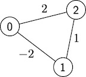

## 1. Shortest shortest paths

**1b)  ** Work and span 

## 2. Expression Trees

**2a)  ** Expression tree algorithm with work and span

**2b)  ** Corresponding arithmetic expression work and span?

**2c)  ** work/span to update a previously computed value

## 3. Improving Dijkstra

**3a)  ** Maximum depth of a $d$-ary heap

**3b)  ** Work done by `delete-min` and `insert` operations in a $d$-ary heap.

**3c)  ** New bound on the work for Dijkstra's using $d$-ary heap 

**3d)  ** What value of $d$ yields an overall running time of $O(|E|)$?
 

## 4. All-pairs shortest paths using Dynamic Programming

**4a)  ** Consider the following graph with 3 vertices.

Compute $\mathit{APSP}(i, j, k)$ for all $i, j, k$.

**4b)  ** Relationship between $\mathit{APSP}(i, j, 1)$ and
$\mathit{APSP}(i, j, 2)$. Can you write $\mathit{APSP}(i, j, 2)$ in
terms of $\mathit{APSP}(i, j, 0)$ and $\mathit{APSP}(i, j, 1)$ only?

**4c)  ** Generalize your observation from b) above to give an optimal substructure property for $\mathit{APSP}(i, j, k).$

**4d)  ** How many distinct subproblems will be computed from scratch, and
what is the resulting work of this dynamic programming algorithm?

**4e)  ** Compare the work of this algorithm against that of just running
Dijkstra $n$ times. Is our dynamic programming algorithm better than this?

## 5. Spanning trees

**5a)  ** Is a solution to MST guaranteed to be a solution to MMET? Why or why not?

**5b)  ** Suppose that the optimal solution to MST is impossible to use for some reason. Describe an algorithm to instead find the next best tree (pseudo-code or English is fine). That is, return the tree with the next lowest weight. 

**5c)  ** What is the work of your algorithm?

